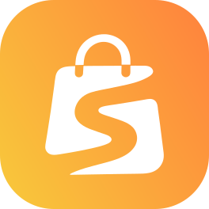

<p align="center">
  
</p>

# Sellrika

Sellrika is a point of sale and an online store in one app, for shops, cafés and restaurants.
It has products, stock, orders, customers, discount codes, reports, email marketing, a REST API, an MCP server and extensions.

Sellrika is source-available. You can read the code and host it yourself.
The hosted version is at [sellrika.com](https://sellrika.com). It runs this same code.

## Run it

You need [Bun](https://bun.sh).

```sh
cp .env.example .env   # set ADMIN_EMAIL, ADMIN_PASSWORD and APP_KEY
bun install
bun run dev            # http://localhost:3000
```

The first start creates the database, the admin user and a first shop.
Sign in with `ADMIN_EMAIL` and `ADMIN_PASSWORD`.

## Run it in production

```sh
docker build -t sellrika .
docker run -p 3000:3000 -v sellrika-data:/app/data -v sellrika-storage:/app/storage --env-file .env sellrika
```

The default database is SQLite. Set `DB_CONNECTION=postgres` to use Postgres, or `DB_CONNECTION=mysql` to use MySQL 8 or MariaDB.
`.env.example` lists every setting.

## Custom domains with SSL

`docker-compose.yml` runs the app behind [Traefik](https://traefik.io). No other tool is needed.

1. Point your app host, `*.<STORE_DOMAIN>` and `DOMAIN_CNAME` at the server in your DNS.
2. Set `APP_HOST`, `ACME_EMAIL`, `APP_URL`, `STORE_DOMAIN` and `DOMAIN_CNAME` in `.env`.
3. Run `docker compose up -d --build`.

Traefik gets a certificate for the app's host.
Every 5 minutes the app checks each shop's own domain. When the domain points at the server, the app writes it into Traefik's folder, and Traefik gets its certificate.

## Documentation

The documentation is on the Sellrika website: [developer.sellrika.com](https://developer.sellrika.com).
It has the API reference and the guide for writing extensions.

## Check your change

```sh
bun run lint && bunx tsc --noEmit -p . && bun run test
bun run test:e2e
```

## Contributing

Pull requests are welcome.
Before we can merge yours, you must agree to the [Contributor License Agreement](CLA.md).
On your first pull request a bot asks you to agree with one comment. You do this once.
You keep the copyright of your work. The agreement lets us license it, also in commercial licenses.

## License

Sellrika is under the [PolyForm Shield License 1.0.0](LICENSE).

We want shops to use Sellrika freely. We only ask that nobody uses our work to compete with us.
Here is a short summary. It is here to help you, it is not the license itself.
If the summary and the [LICENSE](LICENSE) file say different things, the LICENSE file counts.

### What you can do

- Run Sellrika for your own business, on your own server. You may earn money with your shop.
- Use it for as many of your own shops as you need.
- Read the code and change it to fit your needs.
- Write your own extensions and themes. You may sell them too.
- Share copies, with or without your changes, as long as the license and the notices in the [NOTICE](NOTICE) file stay with them.

### What you cannot do

- Provide a product or service that competes with Sellrika. This is true for a paid one and for a free one.
- Offer Sellrika, or a changed copy of it, to other businesses as a hosted point of sale or online store platform.
- Sell or give away Sellrika, or a changed copy of it, as your own point of sale or online store product.
- Remove the license or the notices in the [NOTICE](NOTICE) file from a copy.
- Give your rights under this license to someone else.

### Agencies and freelancers

We say yes to this, in clear words, as the licensor:

- You may install, change and run Sellrika for a client's own shop, and take a fee for your work.
- Each client gets their own installation, for their own business only.
- You may do this for more than one client, one installation each.

What stays not allowed: one platform that many businesses sign up to and share.
That is a product that competes with Sellrika, and it needs a commercial license.

### Do you need more?

If you want to do something from the second list, we are happy to talk about a commercial license.
If you are not sure whether your plan is allowed, please ask us first. We will answer.

Write to [support@sellrika.com](mailto:support@sellrika.com).

Required Notice: Copyright 2026 Zin Kyaw Kyaw (https://sellrika.com)

Licensor Line of Business: Sellrika point of sale and online store platform (https://sellrika.com)
